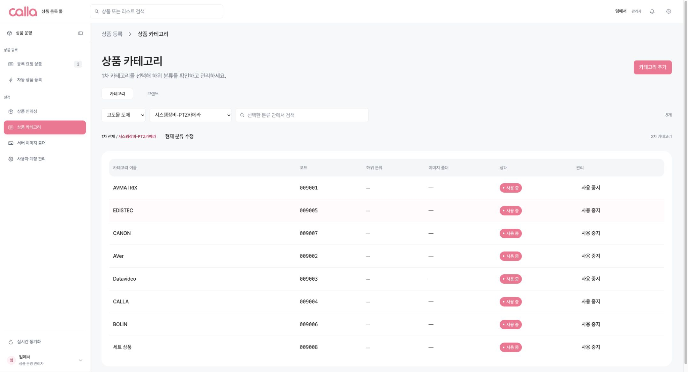
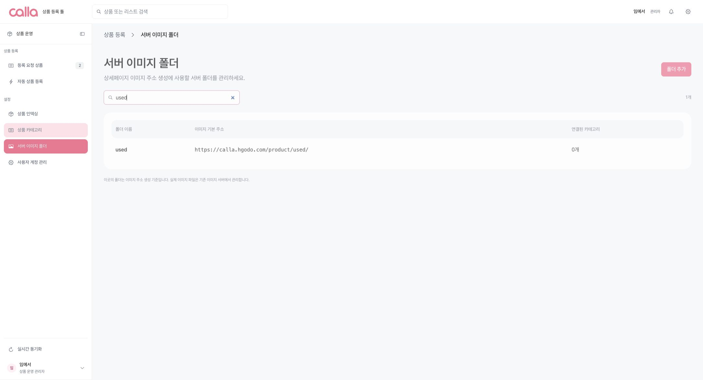
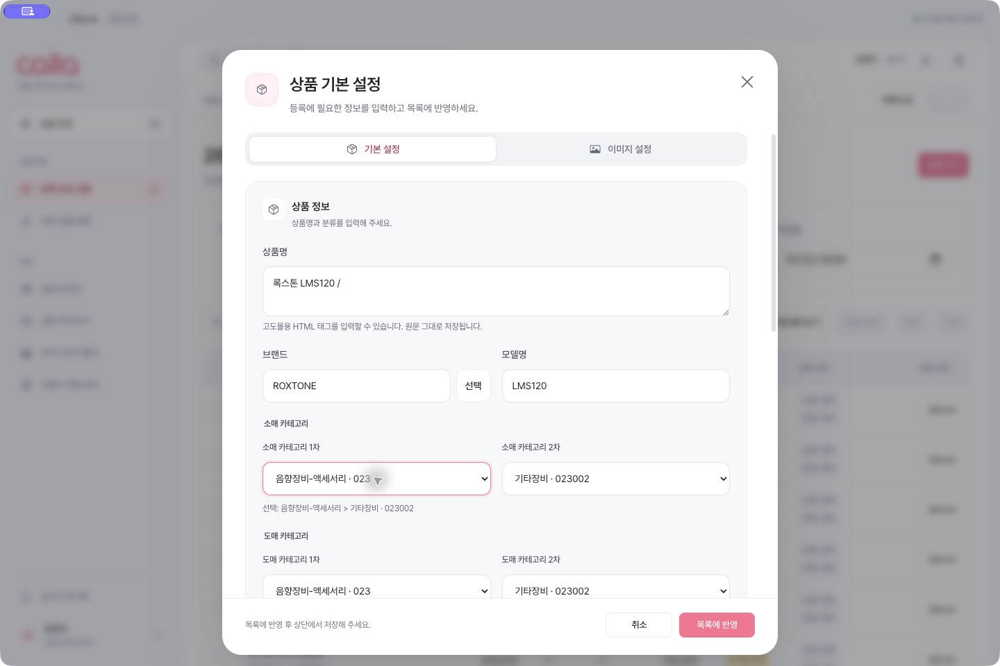
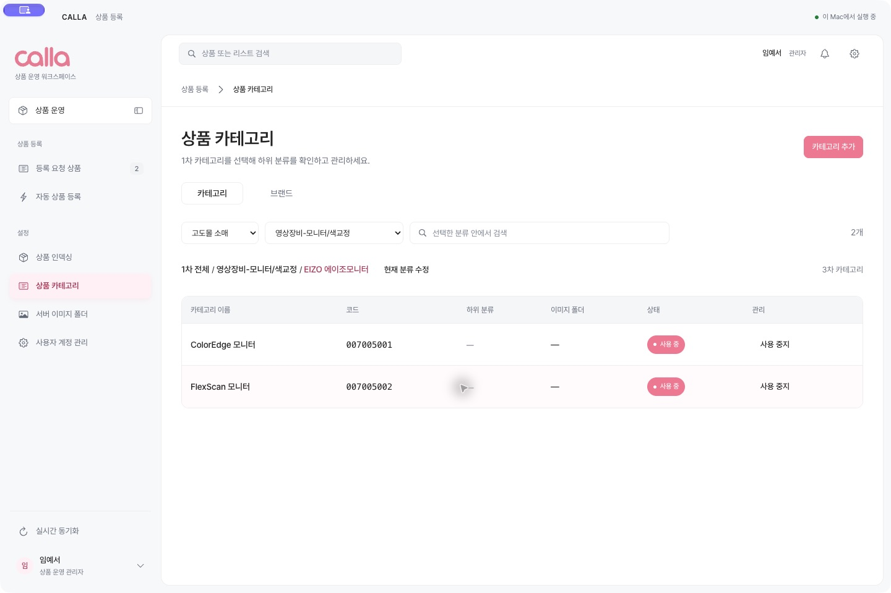

# 2026-10-02 카테고리·이미지 폴더 업데이트

웹 운영 사이트와 Mac 앱 0.2.5에 같은 분류 데이터와 단계별 선택 화면을 적용했다.

## 데이터 대조

사용자가 열어 둔 Chrome의 소매·도매 고도몰 카테고리 관리 화면에서 전체 트리를 펼쳐 코드·이름·부모 코드를 비교했다. 소매는 144개에서 148개, 도매는 135개에서 136개로 늘었다. 기존 분류의 삭제·이름·부모 변경은 없었다.

| 쇼핑몰 | 상위 경로 | 추가 분류 | 코드 |
|---|---|---|---|
| 소매 | 영상장비-모니터/색교정 → EIZO 에이조모니터 | ColorEdge 모니터 | `007005001` |
| 소매 | 영상장비-모니터/색교정 → EIZO 에이조모니터 | FlexScan 모니터 | `007005002` |
| 소매 | 음향장비-마이크 → 기타브랜드 | 7RYMS 세븐림스 | `018005001` |
| 소매 | 음향장비-마이크 → 기타브랜드 | COMICA 코미카 | `018005002` |
| 도매 | 시스템장비-PTZ카메라 | 세트 상품 | `009008` |

전체 코드·이름·부모 코드 스냅샷은 [godomall-categories-2026-10-02.json](data/godomall-categories-2026-10-02.json)에 보관했다. 두 관리자 페이지는 조회만 했다.

첨부된 서버 폴더 목록과 대조해 누락된 `used`를 추가했다. 폴더는 21개에서 22개로 늘었으며 예시 주소는 `https://calla.hgodo.com/product/used/avmatrix-ptz127112a.jpg`이다. 실제 원격 폴더를 생성하거나 이미지 파일을 업로드한 작업은 아니다.

운영 `product_automation_v1` 설정과 앱 기본 설정에 동일하게 반영했다. 운영 설정은 기존 revision을 조건으로 갱신했으며, 카테고리·폴더 외의 설정이 유지됐음을 비교했다. 기존 활성 상태, 폴더 연결 및 목록 순서를 보존했다. 갱신 revision: `2026-10-02 05:57:14.011303+00`.

## 화면 동작

- 상품 편집과 일괄 설정에서 소매·도매별 1차를 선택하면 해당 2차만 표시한다. 하위가 있는 분류는 3·4차도 표시한다.
- 상위를 바꾸면 이전 하위 선택이 해제된다. 소매 선택 변경은 도매에 영향을 주지 않는다.
- 기존 상품을 열면 저장된 전체 경로가 복원된다. 상위만 선택하는 기존 동작, 비활성 분류 표시 및 알 수 없는 저장 코드 보존도 유지한다.
- 일괄 설정에서 “변경하지 않음”인 채널은 기존 분류를 보존한다.
- 카테고리 관리의 기본 화면은 1차만 보여 주고 상위 선택·하위 보기·경로 이동으로 좁혀 볼 수 있다. 검색은 코드와 전체 경로를 대상으로 한다.

## 검증

- `npm test`: 65개 통과. 단계별 선택, 최대 4차, 채널 구분, 상위 변경, 검색, 기존 코드 보존, 전체 관리자 스냅샷 일치를 포함한다.
- `npm run test:desktop`: 5개 통과.
- `npm run build`, Worker 배포 사전 검사 통과.
- 분리된 로컬 데모에서 소매 3차·도매 신규 분류 선택, 저장 후 재열기, 상위 변경, 이미지 주소 생성, 일괄 설정의 미변경 채널 보존을 확인했다. 브라우저 오류 로그는 없었다.
- 실제 웹에서 신규 소매·도매 분류와 `used`를 확인했다.
- 설치된 Mac 앱에서 0.2.5, 기존 로그인 복원, 실행기 연결, 계층별 관리 화면, 기존 상품의 1·2차 선택 복원을 확인했다. 운영 상품 편집 화면은 취소했다.
- 실제 고도몰 상품 등록은 실행하지 않았다.

## 배포와 설치

- 웹: https://cauto.yeseo.im
- Worker 버전: `2c57b40e-2b07-4512-8938-e4e18b3178de`
- 배포된 화면 파일과 로컬 빌드의 SHA-256 일치: `ec66521fb0d9ad7e98a4816bf93ba25ca084da42c4361dc0e43cde052e5735d4`.
- Mac: `/Users/callam4/Applications/CALLA.app`을 0.2.5로 교체하고 다시 열었다. 기존 사용자 데이터와 실행 기록은 유지했다.
- 배포 파일: `release/CALLA-0.2.5-mac-arm64.zip`, `release/mac-arm64/CALLA.app`.
- 기존 설치본 백업: `release/previous/CALLA-0.2.4-before-category-update.app`.
- 앱 서명 검증 통과. 기존과 동일한 ad-hoc 서명 방식이다.

## 확인 화면

